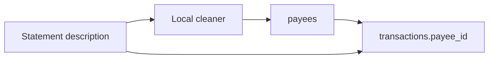

# Payees

## Goal

A transaction can point at a payee. `STARBUCKS #1234` and `Starbucks 5678` become one payee, the ledger can be filtered to that payee, and renaming it updates every row. The description column stays the original statement text. Duplicate detection in [docs/plans/block-duplicate-imports.md](docs/plans/block-duplicate-imports.md) keeps hashing that text, not the payee. No merchant directory and no network call.

## Current behavior

[`transactions`](lib/db/schema.ts) has `description` and no payee. The ledger title and search use that string ([`app/(app)/transactions/page.tsx`](app/(app)/transactions/page.tsx) around the description match). [`components/transaction-form.tsx`](components/transaction-form.tsx) has a single description field. CSV and PDF import store the statement line in `description`.

[docs/plans/on-device-categorization.md](docs/plans/on-device-categorization.md) matches rules on the full normalized description and explicitly leaves payees as a follow-on. Exact description rules still miss `STARBUCKS #1234` after the user taught `STARBUCKS #1000`.

## Design

### Table

In [`lib/db/schema.ts`](lib/db/schema.ts) and the existing `CREATE` / `ALTER` paths in [`lib/db/index.ts`](lib/db/index.ts). `SCHEMA_VERSION` stays `1`.

- `payees`: `id` text PK, `name` text not null (display), `normalized_name` text not null unique, `created_at`, `updated_at`.
- `transactions.payee_id` text null, references `payees.id` `ON DELETE SET NULL`.
- Transfers do not get a payee. A transfer description stays a note.

### Cleaner

`lib/payees/normalize.ts`, pure, tested. Same whitespace and case folding as `normalizeDescription` in the duplicate plan (trim, lowercase, collapse spaces). Then strip only a trailing store or reference token:

- a final token that is only digits (`4821`)
- a final `#` plus digits (`#1234`)
- a final `*` plus digits

Do not cut on the first `*`. `UBER * TRIP 4821` and `UBER * EATS 99` stay different payees. `STARBUCKS #1234` and `Starbucks 5678` become `starbucks`. Further collapsing is a manual merge, not a fuzzy match.

Empty or whitespace-only descriptions produce no payee.

Display `name` is the cleaned text from the first time that key is seen, with the casing of that first line. Later rows reuse the existing row.

### Assign

- Import review (CSV wizard and [`components/pdf-import/pdf-statement-import.tsx`](components/pdf-import/pdf-statement-import.tsx)): show the suggested payee next to the raw description. The user can pick an existing payee or type a new name before import. Excluded duplicate rows do not create payees.
- `POST /api/import/transactions`: upsert by `normalized_name` inside the same write as the transaction, set `payee_id`. Ignore a client-supplied payee id; resolve from the reviewed name.
- Manual create and edit in [`components/transaction-form.tsx`](components/transaction-form.tsx): a payee combobox backed by `GET /api/payees`. Description is labeled as the statement line / note and is still optional. Do not copy the payee into `description`.
- `PUT /api/transactions` may change `payee_id`. It must not recompute `fingerprint` or `source_fingerprint` because of the payee. Those hashes stay on account, date, amount, description, and type.

### Ledger

On [`app/(app)/transactions/page.tsx`](app/(app)/transactions/page.tsx) and the account register in [`app/(app)/accounts/[id]/page.tsx`](app/(app)/accounts/[id]/page.tsx):

- Row title is the payee name when set, otherwise the description, otherwise the category.
- If the description differs from the payee name, show it as the secondary line.
- Search matches payee name as well as description, category, and account.
- A payee filter lists existing payees. Under the list, show the debit total for the rows currently visible (same client-side set as the date-filter plan, once that exists).

### Rename and merge

`app/api/payees/route.ts` (same encryption-key auth as the other routes):

- `GET` list, with transaction count.
- `PATCH` rename: update `payees.name` only. Every linked transaction follows. Do not rewrite `description`.
- `POST /api/payees/merge`: body `sourceId`, `targetId`. Point `transactions.payee_id` at the target, delete the source. Keep the target's `normalized_name` and `name`.

A short list on [`app/(app)/settings/categories/page.tsx`](app/(app)/settings/categories/page.tsx), under categories: name, count, rename, merge into another payee. No separate settings destination.

### Rules seam

If `categorization_rules` from the categorization plan is present, add a nullable `payee_id` on that table. A rule with a payee wins over an exact-description rule for rows with that payee. Learning a category correction also stores the payee id when the row has one. If that table does not exist yet, skip this step; payees still ship, and the rule column can be added with the rules work. Do not change description-only matching.

## Migration

`CREATE TABLE` plus `ALTER TABLE transactions ADD COLUMN payee_id`. Backfill in JavaScript with the cleaner: group existing non-empty descriptions, insert one payee per `normalized_name`, set `payee_id`. Leave blank descriptions null. Do not change descriptions or fingerprints.

## Privacy

Payees are rows in the local SQLCipher file. The cleaner is local code. No lookup service.

## Out of scope

- Payees on transfers.
- Fuzzy or contains matching, and a shared merchant database.
- Changing the duplicate fingerprint inputs.
- Splits, tags, or a separate notes column beyond labeling description as the statement line.
- A payee chart on the dashboard. The ledger filter total is the v1 “spent at X”.

## Tests

`tests/payee-normalize.test.ts`: Starbucks store numbers collapse; Uber Trip and Uber Eats do not; blank input returns null; trailing `*123` strips; internal punctuation stays.

## Size

M. One table, one column, import review, the transaction form, ledger search and filter, and rename/merge. No change to balance math.
